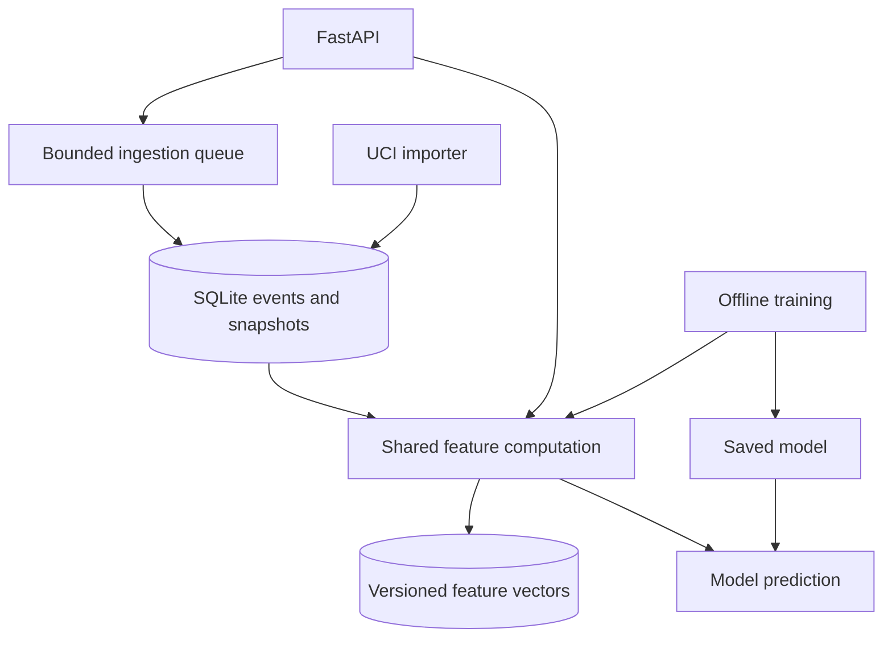

# Point-in-time feature store

A runnable Python project that ingests timestamped purchases, persists versioned customer features, serves them through FastAPI, and trains a repeat-purchase classifier on the same feature API.

The central invariant is **every feature for time `t` uses events strictly before `t`**. A captured database snapshot additionally freezes which events were known, allowing exact replay after out-of-order events arrive.

## Quick start

Requires Python 3.11+. From this directory:

```bash
python -m venv .venv
# macOS/Linux:
source .venv/bin/activate
# Windows PowerShell instead:
# .venv\Scripts\Activate.ps1
python -m pip install -r requirements-tested.txt
python -m pip install -e ".[test]"
python -m unittest discover -s tests -v
python -m pitstore leakage-demo
```

Run the complete synthetic workflow (no data download):

```bash
python -m pitstore demo
python -m pitstore serve --db data/demo.sqlite3 --model artifacts/demo/model.joblib
```

Open **http://127.0.0.1:8000/docs** for the interactive API. `demo` requires an empty database so it never silently combines synthetic and real data. For another demo run choose a new `--db` and `--output`.

The download bundle also includes the processed UCI database and trained model from the verified run. Serve them immediately with:

```bash
python -m pitstore serve --db data/store.sqlite3 --model artifacts/uci/model.joblib
```

Model artifacts must be trusted: joblib uses Python pickle. Regenerate the model in your environment if scikit-learn versions differ; the tested version is recorded in `artifacts/uci/metrics.json`.

## Reproduce with UCI Online Retail

```bash
python -m pitstore download
python -m pitstore import-uci "data/raw/Online Retail.xlsx" --shuffle
python -m pitstore train
python -m pitstore serve --model artifacts/uci/model.joblib
```

The import is idempotent for identical invoices; reimporting the same source does not add purchases. `--shuffle` deliberately destroys ingestion order to exercise event-time correctness. Import uses one atomic transaction. The source workbook is downloaded separately; its URL, download time and SHA-256 are recorded in `data/raw/source.json`.

You can supply your own downloaded `.xlsx` or `.csv`. Use `--source-timezone` to change the explicit **Europe/London assumption** for naive UCI timestamps. Ambiguous/nonexistent local times fail validation. This timezone assumption is a project choice, not a field supplied by UCI.

## What is predicted?

At a customer's invoice completion time `t`, predict whether that customer makes another positive purchase in **`(t, t + 30 days]`**, using only earlier completed invoices. All invoices at the anchor's exact timestamp are excluded from both past features and the definition of a later purchase. There is one training example per customer/timestamp, so multiple invoices at the same time do not duplicate anchors. An invoice spanning several line timestamps is assigned the latest timestamp, preventing its later lines from appearing early.

This estimates repeat purchase conditional on a customer purchasing now. It is not a daily churn predictor for all customers.

| Feature | Definition |
|---|---|
| `purchases_7d`, `purchases_30d`, `purchases_90d` | Number of prior invoices in `[t-window, t)` |
| `spend_7d`, `spend_30d`, `spend_90d` | Positive purchase spend in those windows, in GBP |
| `avg_basket_90d` | `spend_90d / purchases_90d`, or zero |
| `recency_days` | Fractional days since latest purchase within 90 days; 91 if none |
| `has_history_90d` | 1 if there is a purchase in the 90-day window, otherwise 0 |

Amounts are ingested and summed as integer pence. Feature output converts them to GBP. Unknown customers receive the documented cold-start defaults.

The default pipeline uses a 90-day global warmup, removes anchors without a full 30-day outcome window, and holds out the last 25% of distinct eligible prediction timestamps. Training rows are purged unless their **label end is strictly before the first test timestamp**. Scaling is fitted only on the remaining training rows. A logistic-regression model is compared with a training-prevalence baseline using ROC AUC, average precision, Brier score, and log loss. No hyperparameters are selected using the test set.

By default, the latest ingested event time is a conservative observation endpoint. `train --observation-end TIMESTAMP` explicitly asserts that outcome capture is complete through that time. Do not move it forward without that evidence. Label completeness assumes that the imported purchase history is complete inside its observation period.

## Time and reproducibility

For a requested customer, cutoff `t`, and snapshot `s`, a purchase contributes only if:

```sql
customer_id = :customer
AND event_time_us >= :t_minus_window
AND event_time_us < :t
AND seq <= :snapshot_seq
```

| Concept | Contract |
|---|---|
| `event_time` | Time the purchase occurred, normalized to UTC microseconds |
| `ingested_at_us` | Server-assigned ingestion audit timestamp within the write transaction |
| `snapshot_seq` | Committed batch boundary defining the visible event prefix |
| `feature_version` | Version of feature names, formulas, windows and defaults (`retail-v1`) |

`snapshot_seq` is the exact visibility contract; a wall-clock ingestion timestamp is not an exact commit timestamp. Clients cannot backdate ingestion timestamps. Snapshot numbers are local to one database and must come from its ingestion/read responses. Values inside an atomic batch and future snapshot numbers are rejected.

Without a supplied snapshot, a read captures the current committed head. A batch read pins one SQLite read transaction, so simultaneous ingestion cannot make different rows see different heads. Store the returned snapshot alongside a prediction to replay it later. Append-only events make replay possible even if cached feature rows are deleted.

Late events legitimately change newly reconstructed historical features. They **do not** change a read using an earlier captured snapshot. Future and equal-time events cannot change earlier feature values even at a newer snapshot.

**UCI supplies event timestamps, not original ingestion history.** Training on its full imported snapshot reconstructs event-time history and assumes those events were available when they occurred. It does not claim to recreate an actual historical production system's knowledge. For observed live history, record snapshots at prediction time and use those snapshots through the offline query API. Replaying feature vectors also does not recreate a historical model; retain the model artifact separately.

## Architecture



- `pitstore/contracts.py`: validated event/query types, UTC conversion, ordered feature schema.
- `pitstore/store.py`: transactions, indexes, immutable events, snapshot reads and materialization.
- `pitstore/ingestion.py`: bounded queue, one API writer, shutdown drain and backpressure.
- `pitstore/data.py`: UCI cleaning, invoice aggregation, downloader and synthetic generator.
- `pitstore/training.py`: mature labels, temporal holdout, model, metrics and feature export.
- `pitstore/api.py`: FastAPI lifecycle and endpoints.
- `pitstore/cli.py`: commands for import, offline reads, training, serving and the leakage demonstration.
- `tests/`: independent reference checks, boundary cases, importer, API, concurrency and ML integration.

SQLite uses WAL, a 30-second busy timeout and FULL synchronous durability. Each operation owns its connection. API event writes pass through a bounded queue; SQLite also serializes writes from independent clients/processes. Success is acknowledged only after commit. Identical retries are no-ops; reusing an event ID with different data returns HTTP 409 and rolls back the entire batch. A full queue returns HTTP 503 with `Retry-After`.

Accepted queued requests are in memory until committed. A process crash before acknowledgement may lose a queued request; clients retry with stable event IDs. The service drains accepted requests on graceful shutdown. This is idempotent ingestion, not a durable message broker.

Features are computed on demand, then persisted under `(customer, cutoff, snapshot, feature_version)`. Training materializes its feature rows with the same implementation. A new snapshot produces a new cache key, preventing stale results after late data. This reference implementation favors correctness over a constant-time latest-feature lookup.

## API and examples

| Method | Path | Purpose |
|---|---|---|
| GET | `/health` | Read current snapshot and model status |
| GET | `/schema` | Feature order, version and default policy |
| POST | `/events` | Atomically ingest 1–1,000 complete purchase events |
| POST | `/features` | Fetch and persist one point-in-time vector |
| POST | `/features/batch` | Read 1–1,000 queries in one consistent transaction |
| POST | `/predict` | Return repeat-purchase probability and exact feature provenance |

`POST /events`:

```json
{"events":[{"event_id":"invoice:001","customer_id":"alice","event_time":"2024-01-01T10:00:00Z","amount_pence":2500,"units":3}]}
```

`POST /features` and `POST /predict` accept the same query:

```json
{"customer_id":"alice","as_of":"2024-01-02T00:00:00Z"}
```

To replay, add `"snapshot_seq"` with the number returned by the original response. A prediction also returns the model's training snapshot and horizon. `/predict` returns 503 if the server was started without a model. Timezones are mandatory; extra event fields and fractional pence are rejected.

For the bundled UCI database, try customer `17850` at `2011-06-01T12:00:00Z` in `/features`, or run:

```bash
python -m pitstore features --customer 17850 --as-of 2011-06-01T12:00:00Z
python -m pitstore offline examples/queries.jsonl --output artifacts/offline_features.csv
```

`offline` accepts one JSON query per line, including optional snapshots captured in production. Its CSV includes every feature, the cutoff, snapshot and feature version. The full training CSV additionally records targets, label end and train/test/purged membership.

## Validation and limits

Run `python -m unittest discover -s tests -v`. The suite checks half-open windows, microseconds/timezones, same-invoice exclusion, future invariance, out-of-order arrival, snapshot replay without a cache, entity isolation, idempotency, conflict rollback, immutable persistence, concurrent writes, consistent batch reads during a write, bounded admission, shutdown draining, HTTP validation, label maturity and training/serving parity.

`python -m pitstore leakage-demo` prints:

```text
past_only_spend:                       10.0
after_future_and_equal_time_events:    10.0
after_late_past_event:                 30.0
replayed_original_snapshot:           10.0
```

The scope is a local, single-machine educational system. Authentication, external queues, schema migrations, event corrections/retractions, streaming watermark policies and automatic cache retention are extensions. Run on localhost by default. Use a local filesystem for the WAL database; take live backups using SQLite's backup API rather than copying only the database file while writers are active. Feature history grows with distinct queries/snapshots; cache rows can be pruned without deleting events. A new feature definition requires a new version and model retraining.

The importer keeps repeated identical line items because they may be real purchases, excludes cancellation invoices and nonpositive lines, and drops complete invoices containing missing customer identity. It rejects conflicting customer identities within an invoice. Multiple line timestamps are conservatively resolved to the latest eligible line timestamp and counted in the import report. It models gross positive purchase activity, not net revenue after returns. Existing immutable events cannot be partially updated; ingest complete invoices only.

## Sources

- [UCI Online Retail](https://archive.ics.uci.edu/dataset/352/online+retail): Chen, D. (2015), DOI [10.24432/C5BW33](https://doi.org/10.24432/C5BW33). The dataset is supplied under CC BY 4.0; the processed database is derived from it. The raw workbook is not bundled.
- [SQLite WAL](https://www.sqlite.org/wal.html): reader snapshots and serialized writes.
- [FastAPI lifespan](https://fastapi.tiangolo.com/advanced/events/): resource startup and shutdown.
- [scikit-learn temporal validation](https://scikit-learn.org/stable/modules/generated/sklearn.model_selection.TimeSeriesSplit.html): time-ordered evaluation; this project uses a custom calendar-time label purge.

See `VERIFICATION.md` for the actual data counts, test results and model metrics from the included run.

To measure local store latency and concurrent ingestion throughput on your own machine:

```bash
python scripts/benchmark.py --db data/store.sqlite3
```

This reports measured percentiles and scope; it does not include network latency or claim production capacity.
